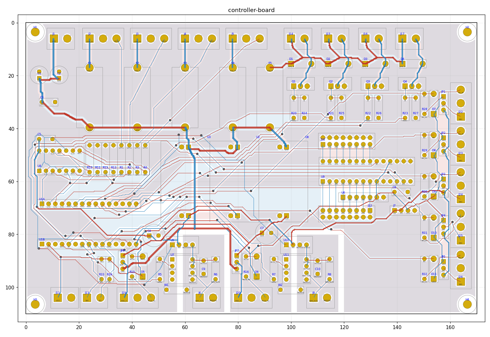

# Controller board (v2)

> **Status: layout done, not ordered yet.** Fully routed, no DRC errors (only silkscreen warnings).
> Four footprints are still assumptions and must be measured on the real parts first; see
> [Check before ordering](#check-before-ordering). The ESPHome packages in [`esphome/`](../../esphome)
> use the pin map below.



One generic board for every room. It runs on 24 V, carries an Arduino Nano ESP32 running
ESPHome, and drives LED strips, fans, plain 24 V loads, sensors and relays. Whatever a room does
not use stays empty. **No mains voltage on the board:** a mains fan is switched by a separate
relay module, in the same enclosure.

## Blocks

```
24V IN ─┬─ fuse 2 A ×4 ── STRIP 1..4 (+24, GND, DATA)  ◄── 74AHCT125 (3.3→5 V) + 220 Ω ◄── ESP
        ├─ fuse 4 A ───── OUT 1..4 (+24, OUT)          ◄── logic-level MOSFET (+ flyback diode) ◄── ESP PWM
        ├─ step-down 5 V ── 74AHCT125, sensors, relay module, isolated converters
        ├─ step-down 9 V ── Nano ESP32 VIN
        └─ step-down 12 V ─ FAN 1/2 supply for computer fans (FAN V jumper: 12 V or 24 V)

FAN 1/2:  ESP PWM ── 6N137 fast optocoupler ══ PWM, GNDiso  (own isolated 5 V per channel)
          V+, GND, TACH ── 1 kΩ + clamp ── ESP pulse counter   (V+ = 12 V or 24 V, jumper FAN V)
          GND bridge: open = isolated (mains EC fan), fitted = computer fan

IN 1..5:  V, GND, SIG ── 1 kΩ + clamp to 3.3 V ── ESP   (jumper per input: V = 3.3 V or 5 V)

I²C ──┬── MCP23017 (0x20) ── IO A header: A0..A7 (+ GND pins)
      │                    └─ IO B header: B0..B7 (+ GND pins); B3..B7 = 433 MHz receiver socket
      └── I2C terminal (3V3, GND, SDA, SCL), 4.7 kΩ pull-ups on the board
MODULES header: 5V, 5V, 3V3, GND (relay module, other modules)
```

## Connections

| Terminal | Pins | Use | Notes |
|---|---|---|---|
| 24V IN | +, − | 24 V power supply | e.g. Mean Well LRS-150-24 |
| STRIP 1..4 | +24, GND, DATA | addressable 24 V LED strips, or an [LED distribution board](../led-distribution-board) | 2 A fuse (5×20 mm) per output |
| OUT 1..4 | +24, OUT | plain 24 V loads: white LED strip (dimmable), solenoid, small fan | low side switched, shared 4 A fuse |
| FAN 1/2 PWM | PWM, GNDiso | PWM input of the fan | isolated; see GND bridge |
| FAN 1/2 | V+, GND, TACH | power and speed signal of computer fans | V+ = 12 V or 24 V, set with the FAN V jumper |
| FAN V 1/2 (jumper) | 12V / 24V | supply voltage on the FAN terminal | **default 12V**; 24V only for 24 V fans |
| IN 1..5 | V, GND, SIG | presence (mmWave), PIR, buttons, any 3.3/5 V signal | supply jumper per input |
| I2C | 3V3, GND, SDA, SCL | I²C sensors (humidity, VOC, light, …) | |
| IO A / IO B | pin + GND pairs | door and drawer contacts, buttons, relay inputs | MCP23017, 3.3 V logic |
| 433 MHz socket | VT, D3, D2, D1, D0, 3V3, GND | 4-channel 433 MHz receiver module | for battery wall switches |
| MODULES | 5V, 5V, 3V3, GND | power for a relay module and other modules | |

### Fan channels
- **Mains EC fan with a PWM input** (e.g. Ruck EM..EC 02, 1–5 kHz, 5–10 V): connect PWM_In and its GND to
  `PWM` and `GNDiso`, leave the **GND bridge open**. The mains of the fan goes through a relay.
- **4-pin computer fan** (25 kHz): V+, GND and TACH on the FAN terminal, the PWM wire on `PWM`,
  **fit the GND bridge**. Two fans in parallel: connect only one tach wire. Keep the current below 1 A per channel.
- **FAN V jumper:** cap on `12V` (default) for 12 V fans, on `24V` for 24 V PWM fans
  (e.g. Noctua industrialPPC-24V; same PWM and tach standard). **A 12 V fan burns out on 24 V.**

## Pin map (Arduino Nano ESP32)

ESPHome uses the GPIO numbers.

| Nano pin | GPIO | Function |
|---|---|---|
| D12, D10, D9, D11 | 47, 21, 18, 38 | STRIP 1, 2, 3, 4 data |
| A3, A7 | 4, 14 | FAN 1, 2 PWM (inverted by the optocoupler) |
| A0, A6 | 1, 13 | FAN 1, 2 TACH |
| D8, D7, D6, D5 | 17, 10, 9, 8 | OUT 1, 2, 3, 4 (MOSFET gates) |
| D4, D3, D2, D0, D1 | 7, 6, 5, 44, 43 | IN 1, 2, 3, 4, 5 (IN 1..3 also analog) |
| A4, A5 | 11, 12 | I²C SDA, SCL |
| A1 | 2 | MCP23017 interrupt (reserved) |
| D13 | 48 | status LED |
| A2 | 3 | not used (strapping pin) |

MCP23017 pins in ESPHome: A0..A7 = 0..7, B0..B7 = 8..15.
433 MHz receiver: D0 = B7 (15), D1 = B6 (14), D2 = B5 (13), D3 = B4 (12), VT = B3 (11).

## Limits
- ESP32-S3: 4 RMT channels, so **4 data lines** at most. One line can drive many strips in
  series; split it into zones in ESPHome with `partition`.
- 8 PWM channels: 2 fans + 4 MOSFET outputs = 6 used.
- Total current: limited by the power supply (LRS-150-24: 6.5 A).

## Bill of materials (per board)

Fit only what a room uses. **Minimum** = needed on every board (Nano, power, level shifter,
expander). The other groups are per function.

| Ref | Part | Qty | Group | Notes |
|---|---|---|---|---|
| U1 | Arduino Nano ESP32 (ABX00083/ABX00092) | 1 | minimum | on 2 × female header 1 × 15 |
| U2 | Mini560-PRO step-down **9 V** | 1 | minimum | Nano VIN; on pin headers (tracks run underneath) |
| U3 | Mini560-PRO step-down **5 V** | 1 | minimum | 74AHCT125, sensors, relay module, isolated converters |
| U4 | SN74AHCT125N, DIP-14 | 1 | minimum | in a socket |
| U9 | MCP23017-E/SP, DIP-28 | 1 | minimum | I/O expander at 0x20, in a socket |
| C1, C2 | electrolytic 47 µF / 50 V, Ø 6.3 mm | 2 | minimum | 24 V input |
| C4 | electrolytic 220 µF / 25 V, Ø 8 mm | 1 | minimum | 5 V rail |
| C3, C5, C8 | ceramic 100 nF (104), 5 mm pitch | 3 | minimum | |
| R33, R34 | 4.7 kΩ | 2 | minimum | I²C pull-ups |
| J1 | screw terminal 2 poles, 5.08 mm | 1 | minimum | 24 V in |
| J11, J13 | screw terminal 2 poles, 5.08 mm | 2 | I²C | |
| J18, J12 | pin header 2 × 8, 2.54 mm | 2 | IO A / IO B | odd row = IO, even row = GND |
| J7 | pin header 1 × 4, 2.54 mm | 1 | modules | 5V, 5V, 3V3, GND |
| U6 | female header 1 × 7, 2.54 mm | 1 | 433 MHz | receiver socket |
| J2–J5 | screw terminal 3 poles, 5.08 mm | 4 | strips | per strip |
| F1–F4 | fuse holder 5 × 20 mm, PCB + fuse 2 A | 4 | strips | per strip |
| R1–R4 | 220 Ω | 4 | strips | series resistor in the data line |
| R10–R13 | 10 kΩ | 4 | strips | pull-down: strips stay dark while the ESP boots |
| J14–J17 | screw terminal 2 poles, 5.08 mm | 4 | OUT | per output |
| Q1–Q4 | IRLZ44N (logic level, TO-220) | 4 | OUT | per output |
| D1–D4 | 1N5819 | 4 | OUT | flyback diode |
| R20–R23, R24–R27 | 100 Ω, 10 kΩ | 4 + 4 | OUT | gate resistor, gate pull-down |
| F5 | fuse holder 5 × 20 mm + fuse 4 A | 1 | OUT | shared by OUT 1..4 |
| U5 / U10 | HLK-1D0505A isolated 5 V | 1 | per fan | |
| U7 / U11 | 6N137, DIP-8 | 1 | per fan | in a socket; the EL817/PC817 is too slow for 25 kHz |
| R5 / R7 | 180 Ω (220 Ω works too) | 1 | per fan | LED current 6N137 |
| R6 / R8 | 2.2 kΩ | 1 | per fan | pull-up of PWM to the isolated 5 V |
| C9 / C10 | ceramic 100 nF | 1 | per fan | |
| J6 / J9 | screw terminal 2 poles | 1 | per fan | PWM, GNDiso |
| J19 / J20 | screw terminal 3 poles | 1 | per fan | V+, GND, TACH |
| R15 / R16, D5 / D6 | 1 kΩ, 1N5819 (or BAT85) | 1 + 1 | per fan | tach protection |
| JP6 / JP7 | pin header 1 × 3 + jumper cap | 1 | per fan | FAN V: 12 V or 24 V |
| W1 / W2 | wire bridge (resistor leg) | 0–1 | per fan | **only** for computer fans |
| U8 | Mini560-PRO step-down **12 V** | 1 | 12 V fans | not needed for mains or 24 V fans |
| C7 | electrolytic 220 µF / 25 V | 1 | 12 V fans | |
| J22–J26 | screw terminal 3 poles | 1 | per input | V, GND, SIG |
| JP1–JP5 | pin header 1 × 3 + jumper cap | 1 | per input | input supply 3.3 V or 5 V |
| R28–R32, D7–D11 | 1 kΩ, 1N5819 (or BAT85) | 1 + 1 | per input | input protection |
| H1–H4 | M3 mounting holes | 4 | | |

The clamp diodes have DO-41 holes, so both a 1N5819 and a BAT85 fit.

## Ordering

[`fabrication/controller-board-gerbers.zip`](fabrication/controller-board-gerbers.zip):
2 layers, **170 × 110 mm**, FR-4, 1.6 mm, 1 oz copper, HASL, white silkscreen, 5 pieces.
Order it together with the [LED distribution board](../led-distribution-board) to share the
shipping cost.

### Check before ordering
These footprints are assumptions. Measure the real parts and adjust `build.py` (custom
footprints) or `parts.py`, then rebuild:
1. **Mini560-PRO** (U2, U3, U8): placeholder 30 × 18 mm, standing, IN+/GND at the top, OUT/GND at
   the bottom, holes at 2.54 mm. Mount the modules on pin headers: tracks run underneath.
2. **HLK-1D0505A** (U5, U10): 4 pins at 2.54 mm in the order GND, VIN, 0V, +VO.
3. **433 MHz receiver** (U6): pin order VT, D3, D2, D1, D0, VDD, GND (pad 1 = square, west).
4. **Fuse holder** (F1–F5): Stelvio-Kontek PTF78 footprint, pins 22.6 mm apart.

### Isolation
The isolated corners (silkscreen ISOLATED 1/2) have their own GND planes, at least 2 mm away
from the rest. This is **functional** isolation, not reinforced insulation for mains: check that
the PWM input of a mains fan is SELV (safety extra-low voltage).

## Rebuilding

The board is generated from [`parts.py`](parts.py) (placement and netlist) by the scripts in
[`../tools`](../tools): `../tools/make-board.sh ../controller-board` places, routes (each attempt in
its own process), runs the DRC and writes the Gerbers and images.
