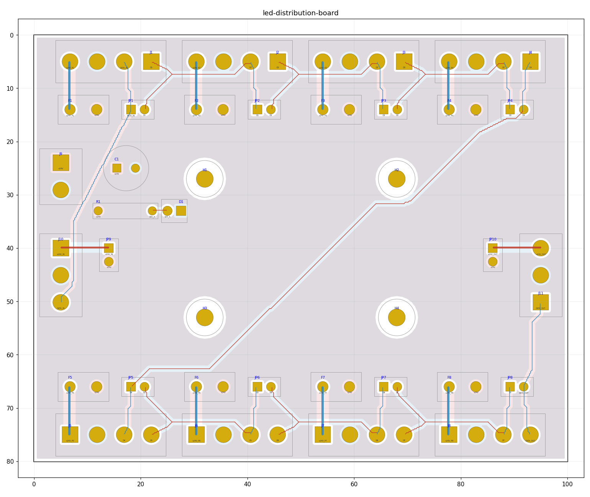

# LED distribution board (8 ports)

Version 1, 2026-11. Connects up to 8 separate LED strips to **one** data line of the controller
board: power goes to every strip in parallel, the data runs through the strips in series.
Boards can be chained for more strips.



## How it works

```
             ┌─ port 1: +24 · GND · DI ──► strip ──► DO ─┐
IN DATA ─────┘                                           │
             ┌───────────────────────────────────────────┘
             └─ port 2 … port 8 ──► DO ──► OUT DATA (to the next board)

24V IN ──┬── PTC ── port 1 +24
         ├── PTC ── port 2 +24      (parallel, each with its own resettable fuse)
         └── …
```

- **Power in parallel:** +24 V and GND go to every port, each through its own PTC.
- **Data in series:** DO of port k is connected to DI of port k+1. In ESPHome the whole line is
  one strip; split it into one zone per strip with a `partition` light
  (see [`walk-in-closet.yaml`](../../esphome/examples/walk-in-closet.yaml)).
- **Empty port:** fit the jumper **bridge=empty**. It connects DI to DO so the data passes.
  **Never fit that jumper on a port with a strip:** two outputs would then drive the same line.
- **Pull-out parts** (shelves with pogo connectors): always on the last used port of the chain.
  A removed part interrupts the data for everything after it.

Each strip needs **4 wires**: out +24, GND and DI, and back DO from the end of the strip.
A 4-core cable (e.g. LiYY 4 × 0.5 mm²) is easiest.

## Connections

| Terminal | Pins (left to right / top to bottom) | Use |
|---|---|---|
| Ports 1–8 | +24, GND, DI, DO | the strips |
| 24V IN (left) | +, − | power of the board, thick wire (1.5 mm²) straight from the power supply |
| IN (left) | +24, GND, DATA | data from the controller board (same order as its STRIP outputs) |
| OUT (right) | +24, GND, DATA | data to the next board |

Jumpers:

| Jumper | Fitted | Open (default) |
|---|---|---|
| JP1–JP8 **bridge=empty** | port empty, data passes | a strip is connected |
| JP9 **24V via IN** | the board is powered through the STRIP output of the controller board (max. 2 A, its fuse); leave 24V IN empty | powered through 24V IN |
| JP10 **24V to OUT** | the next board is powered through this one (small setups only) | only data and GND to OUT |

**Chain the data, not the power:** give every board its own 24 V on 24V IN. GND always goes
along through IN and OUT, because the data signal needs a common ground.

Ports 1–4 are at the top, 5–8 at the bottom. The chain runs 1 → 4, then across the board to 5,
and on to 8 → OUT.

## Current

- The +24 V plane covers the front and the GND plane the back, over the whole board. Pads are
  connected solidly (no thermal spokes), so the planes carry about 6 A: the full output of an
  LRS-150-24. Soldering takes a bit longer: use a hot iron.
- Per port: a 1.1 A PTC (hold current). 1 m of 24 V RGBW strip at full white draws about 0.7 A.
  For a longer strip on one port, use a 1.6 A PTC.

## Bill of materials (per board)

| Ref | Part | Qty | Notes |
|---|---|---|---|
| J1–J8 | screw terminal, 4 poles, 5.08 mm | 8 | or 2 × 2 poles slid together; push-in terminals with 5.0/5.08 mm pitch fit too (1.5 mm holes) |
| J9 | screw terminal, 2 poles, 5.08 mm | 1 | |
| J10, J11 | screw terminal, 3 poles, 5.08 mm | 2 | |
| F1–F8 | radial PTC, **≥ 30 V**, 1.1 A hold, leads 5.0–5.1 mm apart | 8 | e.g. Littelfuse RXEF110 (72 V) or Bourns MF-R110 (30 V) |
| JP1–JP10 | pin header 1 × 2, 2.54 mm + jumper cap | 10 | |
| C1 | electrolytic 47 µF / 50 V, Ø 8 mm, 3.5 mm pitch | 1 | |
| R1 | 4.7 kΩ, 0.25 W | 1 | about 5 mA for the LED |
| D1 | LED 3 mm | 1 | on when 24 V is present |
| H1–H4 | M3 mounting holes | 4 | copper-free ring of Ø 8 mm around each hole |

## Ordering

[`fabrication/led-distribution-board-gerbers.zip`](fabrication/led-distribution-board-gerbers.zip):
2 layers, **100 × 80 mm**, FR-4, 1.6 mm, 1 oz copper (2 oz for extra current margin), HASL,
white silkscreen. Order it together with the controller board to share the shipping cost.

Check before ordering: PTC lead spacing (5.0–5.1 mm, leads up to about 0.7 mm thick); with
push-in terminals, their pitch (5.0 or 5.08 mm) and pin size (1.5 mm holes).

## Rebuilding

The board is generated from [`parts.py`](parts.py) (placement and netlist) by the scripts in
[`../tools`](../tools): `../tools/make-board.sh .` places, routes, runs the DRC and writes the
Gerbers and images.
